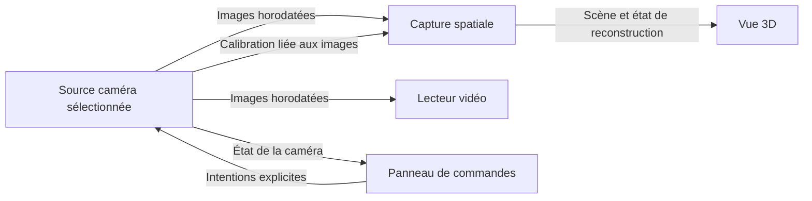

# Applications composables pour OpenDeviceDB

Statut : première proposition, à discuter. Date : 5 novembre 2026.

[Spécification anglaise au format OKF](../../knowledge/specifications/composable-applications.md).
Le propriétaire a autorisé l'implémentation le 5 novembre 2026, après le commit de
la traduction. Les exigences ci-dessous ne constituent pas un état de livraison.

Ce document décrit une évolution du produit. Les formats, noms et chemins proposés
ne sont pas implémentés et ne modifient pas le schéma actuel des fiches. Les termes
« doit » et « requis » désignent les exigences proposées pour cette évolution.

## 1. Intention et décisions issues de la discussion

Depuis une fiche ou l'analyse d'un appareil connecté en USB, une personne doit
pouvoir identifier son appareil, découvrir les fonctions disponibles et les utiliser
avec des composants libres. Elle doit aussi pouvoir assembler ces composants dans
la page, comme des Lego, puis partager son application. La documentation et les liens
vers les projets d'origine restent accessibles.

Les composants de traitement et d'interface existent aussi indépendamment des
appareils. Ils peuvent être découverts dans le catalogue et assemblés en applications
sans fiche associée ni appareil connecté, par exemple pour reconstruire une scène 3D
à partir d'images enregistrées. Les fiches et l'analyse USB sont des portes d'entrée
supplémentaires vers les composants et applications compatibles.

Les orientations exprimées par le propriétaire du projet sont :

- conserver pour commencer les modules WASM, composants web, contrats, compositions
  et tests dans le dépôt OpenDeviceDB, avec une organisation indépendante des fiches ;
- accepter une contribution de traitement ou d'interface indépendamment de tout
  travail sur le protocole bas niveau d'un appareil ;
- ouvrir le portage WASM des composants métier à tout contributeur, indépendamment
  des auteurs du projet source et des personnes qui ont documenté l'appareil ;
- réutiliser les traitements entre appareils : la capture spatiale est le cas de
  référence, avec différents drones ou caméras comme sources d'images ;
- présenter une application prête à utiliser par défaut, avec la composition
  visuelle des blocs accessible comme mode de personnalisation dans la page ;
- permettre d'exporter cette application pour son desktop, avec ses composants et
  sa configuration ;
- permettre aux agents IA de découvrir et d'intégrer les composants dans les
  applications qu'ils créent, via le serveur MCP d'OpenDeviceDB ;
- fournir des composants inspectables par les humains et les agents : contrats,
  comportement documenté, sources correspondantes et tests accessibles ;
- permettre la production directe d'instructions WASM/WAT, en complément des
  portages depuis des langages existants, avec les mêmes exigences de validation ;
- confier à la communauté une part centrale des tests et de la validation sur
  matériel, y compris pour des personnes qui ne programment pas.

Les sections suivantes proposent les mécanismes nécessaires. Le choix des outils,
du format binaire d'interopérabilité et de l'hébergement des artefacts reste ouvert.
La phase de discussion initiale ne lançait aucun développement ni ticket.
L'implémentation a ensuite été autorisée par le propriétaire.

## 2. Parcours utilisateur

### Utiliser une application

1. Depuis le catalogue, une fiche ou l'analyse d'un appareil connecté en USB, choisir une application compatible.
2. Voir ses fonctions, les prérequis de la cible et les modèles/firmwares testés lorsqu'un appareil est nécessaire.
3. Sélectionner les sources nécessaires, autoriser les accès requis et démarrer la session. L'accès à un appareil n'est demandé que si l'application en a besoin.
4. Utiliser les commandes et visualisations proposées.
5. Arrêter la session, enregistrer un résultat ou choisir de partager un rapport.

Les résultats de l'analyse USB donnent directement accès aux fonctions, applications
et composants compatibles disponibles pour l'appareil sélectionné, ainsi qu'au mode
« Personnaliser ». Le passage par une fiche n'est pas obligatoire. Le contexte de
l'appareil sélectionné est conservé lors de l'ouverture d'une application ou de sa
personnalisation ; les autorisations nécessaires restent explicites.

L'écran initial est l'application prête à utiliser : commandes, données et
visualisations. Aucun passage par un graphe ou une page d'assemblage vide n'est
nécessaire pour son utilisation normale. Un bouton « Personnaliser » ouvre l'atelier
Lego à partir de la composition de cette application.

Le premier accès matériel demande une autorisation explicite. La présence d'un
appareil déjà autorisé peut être reconnue sans relancer ses actions précédentes.
Les restrictions des API matérielles doivent être affichées avant de promettre
qu'une application est utilisable dans cet environnement.

### Personnaliser une application

L'atelier s'ouvre sur une copie de travail de la composition choisie, avec ses blocs,
connexions, paramètres et disposition. Une palette propose les blocs disponibles
pour les entrées déjà présentes. La personne peut ajouter ou retirer des fonctions,
régler les blocs et réorganiser l'interface. Deux vues représentent cette même
personnalisation :

- **Agencement** : placer et redimensionner les composants visibles dans la page.
- **Connexions** : déposer les blocs, relier leurs ports et régler leurs paramètres.

Le graphe complet est accessible pour la personnalisation avancée. Les traitements
sans interface y restent visibles. Les erreurs identifient le bloc, le port concerné
et la condition manquante. Un assemblage incomplet peut être sauvegardé en brouillon,
mais pas démarré comme s'il était valide. Les deux vues doivent permettre une
utilisation au clavier.

Les modifications ne changent pas la composition publiée d'origine ni les commandes
d'une session en cours. La personne choisit explicitement d'appliquer/démarrer une
révision valide et peut revenir à l'application. Elle peut enregistrer sa composition
personnalisée ou la proposer au partage selon le parcours de contribution. La création
depuis une page vide reste une entrée distincte pour les auteurs de compositions.

### Exporter pour son desktop

Depuis l'application ou sa personnalisation, le bouton « Exporter une application »
propose une cible disponible adaptée à la machine de l'utilisateur et permet d'en
choisir une autre. Le profil précise le système, l'architecture et le format de paquet.
Le site présente les fonctions compatibles, les prérequis matériels/logiciels et
les éventuelles dépendances réseau, puis prépare une application téléchargeable.
La personne peut l'installer ou la lancer selon le format sans compiler le projet
elle-même. Elle retrouve sa composition, ses réglages et son interface.

Le téléchargement d'une composition et celui d'une application desktop sont deux
livrables distincts. L'application doit inclure le moteur hôte, les modules WASM,
les interfaces, le verrouillage des versions et les ressources redistribuables
nécessaires. Les prérequis système éventuellement non embarqués sont indiqués.
Les autorisations matérielles sont acquises sur la machine de destination ; elles
ne sont pas transférées depuis le navigateur.

Une application dont toutes les fonctions et ressources sont locales doit pouvoir
être utilisée sans accès à OpenDeviceDB après son installation. Les fonctions qui
exigent un service distant gardent cette dépendance visible. Le paquet donne accès
à sa composition, aux licences et aux sources correspondantes pour permettre sa
reconstruction et sa modification.

### Réutiliser les composants avec un agent IA

Une personne peut demander à son agent, par exemple : « Crée une application desktop
qui lit ma caméra et utilise le composant de capture spatiale d'OpenDeviceDB. »
L'agent consulte le catalogue via MCP, choisit des versions compatibles avec la
cible, récupère les contrats et exemples, puis intègre les composants dans le projet
de l'utilisateur. Ce parcours est également ouvert aux applications métier créées
hors de l'éditeur visuel.

L'agent peut assembler une composition existante ou utiliser directement les API
publiques des composants via une bibliothèque d'intégration documentée. La création
de l'application ne nécessite pas de réécrire le protocole déjà fourni par un module.
L'application obtenue exécute les composants avec son hôte ; elle peut fonctionner
ensuite sans agent IA ni connexion au serveur MCP.

### Contribuer

Une personne peut publier un adaptateur, un traitement, un portage WASM, une
interface, une composition, une fixture de test ou un rapport matériel. Aucune
contribution au protocole bas niveau ni au dépôt source d'origine n'est un prérequis
pour les autres contributions. Les auteurs peuvent travailler sur des données
enregistrées ou des simulateurs ; les propriétaires d'appareils peuvent ensuite
apporter les essais matériels.

## 3. Les objets du système

| Objet | Contenu et rôle |
| --- | --- |
| Fiche d'appareil | Identité, sources, variantes et liens vers les usages/compositions compatibles. |
| Composant | Unité versionnée avec source, licence, ports, paramètres, environnement et tests. |
| Contrat de connexion | Définition versionnée des données, commandes et contraintes d'un port. |
| Composition | Instances de composants, versions, connexions, paramètres, sources à sélectionner et disposition de l'interface. |
| Rapport de test | Résultats rattachés à des versions exactes et à un environnement, avec la nature de chaque preuve. |

Un composant possède une identité indépendante des fiches ; sa publication et son
utilisation ne nécessitent pas de le rattacher à un appareil. Sa compatibilité dépend
de ses contrats, de ses ressources et de son environnement d'exécution. Il peut avoir
plusieurs rôles ou être constitué d'un groupe de blocs :

- **Adaptateur** : dialogue avec un appareil et expose des fonctions communes.
- **Traitement** : transforme des données, par exemple des images en géométrie 3D.
- **Interface** : visualise un résultat ou émet des intentions de commande.
- **Sous-composition** : encapsule un assemblage et expose ses ports et paramètres.

Plusieurs modèles peuvent partager un adaptateur de protocole, avec des profils
décrivant leurs particularités. Une sous-composition est un composant partageable ;
ses dépendances sont explicites et les références récursives sont refusées.

### Portage communautaire des composants métier

Le point de départ d'un composant peut être un projet libre existant en Python,
C/C++, Rust ou dans un autre environnement, avec des dépendances natives. La fiche
peut référencer ce travail avant qu'un module pour navigateur soit disponible.
Le portage progressif par la communauté fait partie du fonctionnement prévu du
registre.

Tout contributeur peut proposer le portage de la partie métier utile, son adaptation
aux contrats communs et son empaquetage en WASM. Il n'a pas à être l'auteur du dépôt
initial, à avoir documenté le protocole ou à posséder l'appareil. Un autre contributeur
peut fournir l'interface web et un propriétaire de matériel peut réaliser les essais.
Chaque contribution conserve son attribution et respecte les licences des sources
réutilisées. Un portage peut être maintenu dans OpenDeviceDB sans attendre sa fusion
dans le dépôt amont.

La contribution peut porter sur une bibliothèque ou une fonction extraite ; le
registre n'exige pas le portage de toute l'application d'origine. Les parties
réutilisées, adaptations, dépendances et limites sont décrites explicitement.

Le suivi du portage distingue trois stades : **source référencée**, **portage en
cours**, **artefact WASM disponible pour une cible déclarée**. Il est indépendant des
preuves de fonctionnement : tests sur fixtures, résultats matériels rapportés et reproductions
documentées. Un artefact disponible peut encore manquer de tests matériels.

Une proposition de portage indique le projet/version source, les fonctions visées,
le contrat envisagé, les travaux déjà publiés et les besoins restants. Les fiches et
le catalogue permettent de découvrir ces propositions et d'y contribuer. Le module
n'apparaît comme exécutable dans la palette qu'après publication d'un manifeste et
d'un artefact compatibles avec le moteur ; les propositions restent consultables.
La progression d'un portage n'empêche pas l'utilisation d'autres composants prêts.

### Cas de référence : capture spatiale



La source peut être un adaptateur de drone, une caméra accessible au navigateur ou
un enregistrement. Remplacer la source ne doit pas demander de modifier le traitement
ou la vue 3D si leurs contrats d'entrée restent satisfaits.

La compatibilité reste conditionnelle aux données disponibles. Une calibration
absente, un format d'image incorrect ou des horloges incompatibles doivent produire
une explication, pas une connexion silencieuse.

Le [paquet Spatial Capture 3D](https://github.com/smichea/spatial-capture-3d) actuel
est une référence fonctionnelle, pas un module WASM disponible. Son
[manifeste Python](https://github.com/smichea/spatial-capture-3d/blob/e14ec1702e934d473c3327bcaaeeafba061bc127/pyproject.toml)
inclut notamment pycolmap ; son README décrit aussi des outils natifs externes et
une acquisition continue encore expérimentale. Son portage WASM est un exemple de
contribution métier ouverte à la communauté selon le parcours ci-dessus. Ses auteurs,
les auteurs d'interfaces et les testeurs matériels peuvent être des personnes
différentes. Les performances du portage et l'accès au flux du Neo 2 depuis un
navigateur seront établis par ces travaux et leurs essais. Le contrat doit permettre
cette famille d'usages sans annoncer que toute caméra est déjà compatible.

## 4. Contrats : les prises des Lego

Chaque port déclare une direction, une nature, un contrat et sa version, ainsi que
ses contraintes. Trois natures sont proposées :

| Nature | Exemples | Comportement |
| --- | --- | --- |
| Valeur/état | Calibration, paramètres, état de connexion | Dernière valeur connue et notification des changements. |
| Flux/événement | Image, mesure, nouvelle révision de scène | Éléments ordonnés, datés et soumis à une politique de débit. |
| Action | Lire une information, changer un réglage | Requête/réponse, identifiant et résultat explicite. |

Les premiers contrats à définir sont les images, la calibration, les mesures avec
unités, les scènes 3D et les actions. Les noms illustratifs pourraient être
`odb.video.frame/1`, `odb.camera.calibration/1` ou `odb.scene.revision/1`.

Le contrat précise, selon le cas : format et dimensions, unités, repère spatial,
origine et domaine d'horloge, identifiant de source et de session, validité de la
calibration, valeur inconnue, erreur et version. Une transformation d'image doit
mettre à jour les informations géométriques affectées. Un changement de caméra crée
un nouveau contexte ; les données de sessions différentes ne sont pas mélangées.

L'éditeur vérifie les directions, contrats, versions et contraintes avant le
démarrage. Un convertisseur explicite peut rendre deux ports compatibles. Un même
nom de port ou une conversion numérique ne suffit pas à prouver la compatibilité.
Les contraintes qui dépendent des données sont aussi contrôlées à l'exécution.

Une sortie peut alimenter plusieurs entrées. Chaque consommateur précise sa
politique : conserver le dernier élément, conserver tous les éléments avec une
limite, ou ralentir le producteur si celui-ci le permet. Les pertes et retards sont
observables. Les files ont une limite ; les horodatages d'origine sont conservés.
Les données volumineuses circulent dans des buffers ou ressources gérés par le
moteur, avec des règles d'ownership, de copie et de libération définies dans l'API.
Elles ne sont pas sérialisées image par image dans le fichier de composition.

Pour une première version, le graphe des données est sans cycle. Les actions suivent
des connexions distinctes ; elles ne sont ni répétées ni rejouées automatiquement à
la reconnexion. Une boucle de commande continue demanderait un contrat ultérieur
décrivant son rythme et son arrêt.

## 5. Manifestes et compositions sauvegardées

### Manifeste d'un composant

| Groupe | Informations requises proposées |
| --- | --- |
| Identité | Identifiant stable, version, description, auteurs et responsables. |
| Liberté et sources | Licence SPDX, dépôt/commit du portage et de chaque source amont réutilisée, attributions, recette de compilation et licences des dépendances distribuées. |
| Exécution | WASM, interface web ou sous-composition ; version d'API du moteur ; points d'entrée ; fonctionnalités et services hôtes requis ; cibles déclarées et testées. |
| Artefacts | Chemin ou URL de publication contrôlée, empreinte, provenance de compilation et source correspondante. |
| Inspection | Contrats et documentation de comportement, sources lisibles liées au binaire exact, exemples/tests et références de symboles ou de débogage lorsqu'elles existent. |
| Connexions | Ports, contrats, versions, contraintes et paramètres validables. |
| Accès | Appareils/interfaces et opérations nécessaires ; accès réseau ou fichiers éventuels. |
| Ressources | Mémoire, taille des files et autres limites supportées par le moteur. |
| Tests | Scénarios, fixtures, résultats attendus et instructions d'observation humaine. |

Les paramètres sauvegardables sont distingués des secrets et du contexte de session.
Une configuration de composant est validée avant son exécution.
Ces exigences portent sur un composant exécutable ; une proposition de portage peut
être publiée avec les informations de suivi décrites plus haut, sans faux artefact
ni contrat présenté comme finalisé.

### Composants inspectables par les agents

La publication doit permettre d'accéder aux informations nécessaires pour utiliser
un composant et à ses sources pour étudier ou modifier son implémentation. Le parcours
normal n'exige pas de reconstruire un programme de haut niveau à partir du binaire.
Le paquet d'inspection peut être livré à côté du module ; ses références et empreintes
font partie de la même publication versionnée.

Il contient les interfaces typées, les entrées/sorties, unités, effets, préconditions,
erreurs, états et limites documentés, ainsi que les services hôtes nécessaires. Les
conditions vérifiables automatiquement sont représentées de façon structurée ;
les hypothèses et observations humaines restent identifiées. Les noms métier des
fonctions et paramètres sont conservés dans les interfaces et les sources.

Les sources correspondent à l'artefact publié : commit, recette de construction,
versions des outils et empreintes sont épinglés. Pour un module écrit directement
en WASM, la représentation WAT lisible sert de source, avec les informations de
construction nécessaires. Les noms et informations de débogage disponibles sont
conservés ou fournis séparément avec une correspondance explicite. Une conversion
du binaire en WAT ne reconstitue pas à elle seule les intentions et abstractions
d'un programme source optimisé.

WIT est un candidat pour les interfaces typées ; il décrit les contrats d'échange,
sans définir tout le comportement de l'implémentation. Les descriptions fonctionnelles
et tests restent nécessaires. Les contrôles de publication vérifient les signatures
et services déclarés contre les imports/exports réels, la correspondance des artefacts
et les scénarios exécutables disponibles. Ils distinguent une déclaration de
comportement, un résultat de test et une propriété effectivement vérifiée.

L'inspection des métadonnées et de la structure du binaire ne nécessite pas de lancer
le module. Un agent peut récupérer seulement les interfaces, fonctions sources ou
fixtures utiles. Une composition partageable fournit déjà une représentation lisible
du graphe ; les sources des blocs permettent d'examiner leur logique interne.

### Production directe en WASM/WAT

Deux voies de production sont acceptées : compiler/porter du code libre existant
ou produire directement les instructions WASM. WAT est la représentation textuelle
standard de ces instructions. Un agent peut la générer puis utiliser un assembleur
et un validateur pour obtenir un binaire. Une API de construction d'instructions
typées avec encodage binaire est une autre piste à expérimenter.

Le parcours proposé est : besoin et contrats, sources WAT ou construction structurée,
assemblage/encodage, validation WASM, tests de contrat et de comportement, puis
publication versionnée. Les sources WAT lisibles sont conservées même si un outil
produit directement le binaire. La conversion en binaire reste une étape de
construction ; l'hôte peut ensuite compiler ou interpréter le module à l'exécution.

Cette voie évite d'imposer un langage de haut niveau à l'auteur. Son intérêt par
rapport à un portage classique est à évaluer sur des tâches concrètes : décodeur de
protocole, transformation de flux et calcul métier. L'évaluation porte sur la
correction, les ressources, les performances et la facilité de modification, sans
supposer que la génération directe est supérieure pour les algorithmes complexes.
Les portages de bibliothèques existantes restent des contributions de premier plan.

Les deux voies suivent les mêmes règles de contrat, licence, traçabilité et test.
La validation WASM établit la bonne formation du module et ses contraintes de types ;
les résultats métier sont évalués par les tests et la revue correspondants. Aucun
module n'est présenté comme matériellement validé du seul fait qu'il est généré par
une IA ou accepté par un validateur.

### Description d'une composition

Le format doit être lisible, versionné, importable et exportable. Il conserve les
instances, versions et empreintes exactes, connexions, paramètres, ports publics,
emplacements de sources matérielles et disposition des deux vues. Il ne conserve
aucune autorisation du navigateur, clé ou identité personnelle de périphérique.

Exemple conceptuel, sans valeur de schéma définitif :

```yaml
format: odb-composition/1
id: examples/camera-preview
nodes:
  - id: camera
    component: examples/camera-adapter
    version: 0.0.0
    source_slot: selected-camera
  - id: viewer
    component: examples/video-viewer
    version: 0.0.0
connections:
  - from: camera.frames
    to: viewer.frames
layout:
  application:
    viewer: { x: 0, y: 0, width: 12, height: 8 }
```

Ces identifiants sont fictifs. Un export exécutable inclura le verrouillage des
artefacts et dépendances. L'import ne démarre rien et ne télécharge aucun code
arbitraire à exécuter avant validation et choix de l'utilisateur. Changer une version
crée une nouvelle révision avec un nouveau périmètre de validation.

### Paquet d'application et profil de cible

Un export épingle la composition, la version du moteur hôte, les artefacts et leurs
empreintes, les services matériels requis, les ressources et les informations de
licence/source. Son profil identifie la cible et ses variantes, par exemple système,
architecture et fonctionnalités WASM nécessaires. La résolution vérifie toute la
chaîne de dépendances ; un composant disponible pour le web n'est pas supposé
compatible avec un hôte desktop ou mobile.

L'export signale une cible incompatible ou une ressource non redistribuable avant
de proposer une application prête à télécharger. Il conserve les propriétés
d'isolation et d'autorisation du moteur. Les réglages privés, secrets et identifiants
de session ne sont pas incorporés à un paquet partagé.

Produire les paquets implique une chaîne de construction par cible et, selon la
distribution, signature/notarisation. Le site statique existant ne fournit pas cette
chaîne : il faut choisir entre un service de génération, une CI dédiée ou une
stratégie d'assemblage d'hôtes préconstruits. Cette décision doit couvrir coûts,
accès aux outils de signature, confidentialité des compositions et disponibilité
des cibles. Un simple projet source à compiler ne satisfait pas le parcours
d'export desktop destiné à une personne qui ne développe pas. Tauri est une piste
à évaluer pour l'enveloppe applicative et le packaging, sans choix arrêté ; voir
[sa documentation de distribution](https://v2.tauri.app/distribute/).

Le suivi distingue un export demandé, sa préparation/construction, un paquet
disponible et un échec. La construction d'un paquet ne vaut pas validation de ses
fonctions sur matériel. Un export conserve les versions choisies ; les mises à jour
suivent une nouvelle résolution explicite.

## 6. Moteur d'exécution et hôtes

### Contrat commun et environnements

Le moteur expose le même contrat métier aux composants, avec des implémentations
des services adaptées à chaque environnement. Le premier hôte proposé est la page
web ; la conception doit aussi permettre un hôte desktop et l'intégration dans des
applications mobiles ou serveur. Le portage communautaire peut cibler un sous-ensemble
de ces environnements. Chaque cible disponible et chaque cible testée sont déclarées
séparément.

| Hôte | Accès et présentation envisagés |
| --- | --- |
| Navigateur | API web disponibles et autorisées ; composants web dans la page. |
| Desktop | Moteur WASM embarqué, services matériels natifs et interface web embarquée ou native. |
| Mobile | Moteur embarqué ou WebView, avec services et permissions propres à Android/iOS. |
| Serveur | Exécution sans interface graphique, entrées/sorties explicites et accès matériel local ou distant déclaré. |

La logique métier réutilisable passe par les services hôtes déclarés, sans imposer
de dépendance aux objets du navigateur. Réutiliser un même artefact requiert des
interfaces et fonctionnalités compatibles. Les interfaces web peuvent être
réutilisées dans une WebView ; une interface native utilise les mêmes contrats
avec ses propres éléments visuels. Un profil serveur définit les entrées et sorties
utiles sans dépendre d'un composant d'affichage. Il n'obtient pas implicitement accès
aux appareils branchés sur l'ordinateur d'un utilisateur.

### Cycle d'une session

Le moteur résout les composants, valide le graphe, fournit les accès autorisés et
relie les blocs. Son cycle est : préparer, lier, démarrer, arrêter, libérer. Les
dépendances sont préparées avant les producteurs. Un échec pendant la préparation
libère les ressources déjà acquises.

Une session possède ses instances et son contexte matériel. Un adaptateur ouvre
une seule session par appareil/interface contrôlée, puis distribue les données aux
consommateurs autorisés. Le moteur signale les conflits d'accès. À l'arrêt ou au
débranchement, il annule les actions en attente, ferme les ressources et marque les
sorties terminées ou périmées. Il ne présente pas une ancienne image comme une
mesure ou une vue actuelle.

Les traitements coûteux sont exécutés hors du fil d'interface lorsqu'il existe. Dans
le navigateur, les Web Workers offrent ce mécanisme ; ils ne donnent pas à eux seuls
un modèle d'autorisation des plugins. Voir [Using Web Workers](https://developer.mozilla.org/en-US/docs/Web/API/Web_Workers_API/Using_web_workers).

### Accès matériel et code contributeur

Le moteur fournit au WASM les fonctions nécessaires déclarées par son manifeste.
Le module n'obtient pas implicitement accès au réseau, aux fichiers ou à tous les
appareils. La compilation WASM ne remplace pas les restrictions du navigateur ni les
prérequis du système. Voir [WebAssembly security](https://webassembly.org/docs/security/)
et [WebUSB](https://developer.mozilla.org/en-US/docs/Web/API/WebUSB_API).

Les intentions émises par une interface passent par le moteur avant d'atteindre
l'adaptateur. Les permissions du navigateur et les opérations autorisées à un bloc
sont deux niveaux distincts. Les commandes sont rattachées à l'appareil, à la session
et à la fonction autorisés ; un accès à une mesure ne confère pas toutes les actions.
Lire un résultat peut nécessiter l'envoi d'une requête protocolaire : l'effet autorisé
est défini par la fonction, pas seulement par le sens des transferts USB.

Pour les interfaces contributrices, la proposition est d'exécuter les Web Components
dans des cadres isolés et de les relier par des messages validés. L'enveloppe est
fournie par le moteur ; le code contributeur n'est pas importé dans la page hôte avec
ses privilèges. Le Shadow DOM sert à l'encapsulation de l'interface, pas à isoler les
droits d'exécution. Le détail des origines, du sandbox, de la CSP et des canaux de
messages doit être défini et vérifié avant toute exécution de plugins tiers. Voir
[Web Components](https://developer.mozilla.org/en-US/docs/Web/API/Web_components) et
[iframe sandbox](https://developer.mozilla.org/en-US/docs/Web/HTML/Reference/Elements/iframe#sandbox).

Le choix proposé pour le premier périmètre est une exécution locale dans le
navigateur, complétée par l'objectif d'export desktop et d'intégration via MCP. Les
échanges restent limités aux accès déclarés. Le téléchargement d'un module
est distinct d'un envoi de mesures ; aucune collecte de données ou publication de
rapport n'est implicite. Les services natifs d'un hôte desktop peuvent étendre les
transports disponibles, via un environnement et des permissions déclarés distincts.

## 7. Registre, sources libres et intégration aux fiches

Pour commencer, le dépôt OpenDeviceDB accueille les sources, manifestes, contrats,
composants d'interface, compositions et tests. Aucun dépôt séparé n'est prévu à cette
étape. Les composants y sont organisés indépendamment des fiches : une fiche ou une
application référence leurs identifiants et versions, sans dupliquer leur code.

Les bibliothèques amont réutilisées restent attribuées et liées ; un portage conserve
son origine et les sources nécessaires à sa reconstruction. Le code et les artefacts
distribués doivent respecter leur licence et la [politique du projet](../../POLICY.md).

Les artefacts compilés sont rattachés à une publication et à leurs sources exactes.
Un premier choix proposé est de les publier via la CI et les releases du dépôt,
avec un index statique épinglant leurs empreintes. Leur stockage dans l'historique
git ou dans les releases reste à décider. Une empreinte identifie un artefact ; elle
ne constitue pas une preuve de bon fonctionnement.

Deux catalogues se répondent : appareils et composants/compositions. Le catalogue
des composants et applications est directement consultable, sans sélection préalable
d'un appareil. Une fiche référence les adaptateurs connus et les applications
possibles. La résolution distingue : correspondance d'identifiants, satisfaction
des contrats, environnement disponible et preuves de fonctionnement. Un VID:PID
partagé par un adaptateur série
ou un bootloader n'établit pas le modèle physique ; la sélection/probe appropriée
reste nécessaire. Tout probe et son effet doivent être déclarés.

Les statuts actuels des fiches sont conservés. L'existence d'un firmware libre ou
d'un protocole documenté n'implique pas qu'une fonction soit utilisable sur une
cible donnée. Les résultats d'exécution sont présentés par application, fonction,
variante et environnement. Les anciennes fiches sans module restent valides.

La publication de composants passe par les contributions du dépôt. Il faut pouvoir
déprécier ou retirer une version de la découverte par défaut, indiquer la raison et
prévenir l'utilisateur d'une composition affectée. Une mise à jour ne remplace
jamais silencieusement les versions verrouillées d'une composition.

### Découverte et intégration via MCP

Le serveur MCP existant expose principalement les fiches et le suivi de recherche ;
voir son [interface actuelle](../../packages/mcp/README.md). Cette évolution ajoute
la découverte et l'intégration des composants. Les outils ci-dessous sont des noms
proposés, pas des outils déjà disponibles.

| Opération proposée | Résultat attendu |
| --- | --- |
| `search_components` | Recherche par fonction, contrat, appareil ou cible, avec disponibilité et niveau de test. |
| `get_component` | Version précise, manifeste, ports, dépendances, licences, preuves et références d'artefacts/sources. |
| `inspect_component` | Paquet d'inspection, structure/imports/exports du binaire, contrats, sources et tests liés à la même version, sans exécuter le module. |
| `resolve_composition` | Versions compatibles et verrouillage, composants manquants, services hôtes requis et diagnostics pour une cible. |
| `validate_composition` | Contrôles de structure, connexions et paramètres ; conditions matérielles encore inconnues distinguées des erreurs. |
| `get_integration_guide` | API d'intégration, exemples, ressources de projet et tests de contrat adaptés à la cible et au langage supporté. |
| `prepare_app_export` | Plan d'export, prérequis et référence vers le parcours de construction ; aucune compilation ou publication implicite. |

Les contrats, guides et exemples peuvent être exposés comme ressources MCP ; les
requêtes et validations comme outils. Le protocole fournit ces mécanismes, tandis
que les opérations du registre restent propres à OpenDeviceDB. Références :
[outils MCP](https://modelcontextprotocol.io/specification/2026-07-28/server/tools)
et [ressources MCP](https://modelcontextprotocol.io/specification/2026-07-28/server/resources).

Un résultat exploitable par l'agent inclut une version du format de réponse, des
identifiants/versions exacts, la cible résolue, les contrats, les besoins hôtes et les
preuves connues. Les exemples et bindings fournis correspondent aux mêmes versions.
Les artefacts volumineux sont référencés par URI et empreinte ; les contrôles d'accès
et de licence s'appliquent aussi à leur récupération. Un résultat partiel explique
ce qui manque sans inventer une API, un portage disponible ou un test matériel.

Les guides doivent permettre d'intégrer un composant ou un assemblage dans un projet
externe en utilisant la bibliothèque d'hôte/SDK correspondante. Le contrat commun et
les tests de conformité sont partagés avec l'éditeur web et l'exporteur desktop.
Un agent peut produire son propre écran ou réutiliser des interfaces du registre.
Son projet conserve le verrouillage et les attributions des composants réutilisés.

Le périmètre de découverte/préparation est sans effet sur le matériel. Écrire dans
le projet, exécuter un build ou tester un appareil relèvent ensuite des outils et
autorisations de l'environnement de l'agent. Publier une application ou commander
un appareil n'est pas une conséquence implicite d'une recherche MCP. Ces opérations
ne sont pas déclenchées par la rédaction de cette spec.

## 8. Validation communautaire

Chaque composant fournit des tests de contrat et des scénarios reproductibles.
Les traitements et interfaces peuvent être testés sur des fixtures sans appareil.
Les adaptateurs ajoutent des scénarios guidés sur matériel ; les observations
humaines sont séparées des assertions automatiques. Une réponse décodée et une
mesure comparée à une référence constituent des preuves différentes.

Le bouton « Tester et contribuer » permet de choisir les fonctions à essayer,
consulter les opérations prévues, lancer le scénario puis relire un rapport avant
de le partager. Les opérations qui changent un réglage sont explicites. Le premier
périmètre proposé n'inclut pas le flash de firmware depuis les pages.

Le rapport conserve : versions/empreintes du composant, de la composition et de la
suite de tests, variante d'appareil, firmware s'il est connu, environnement du moteur,
date, résultats par fonction (`réussi`, `échoué`, `partiel`, `ignoré`, `inconnu`),
assertions automatiques, observations humaines et éléments de reproduction choisis.
Les numéros de série, identifiants personnels, secrets et captures privées sont
exclus du rapport public par défaut. L'utilisateur revoit toute pièce jointe.

L'affichage distingue une compatibilité déclarée, un test sur fixture, un résultat
matériel rapporté et une reproduction matérielle documentée. Il affiche les succès
et les échecs comparables, leur date et les conditions, sans étendre un résultat à
d'autres versions ou variantes. Une confirmation indépendante doit être présentée
comme telle, avec sa provenance ; plusieurs soumissions identiques ne deviennent
pas plusieurs confirmations indépendantes.

La communauté peut corriger et contester les rapports. Les mainteneurs gèrent les
doublons et examinent les éléments nécessaires avant de promouvoir une preuve au
niveau « vérifié ». Les règles existantes de [SPEC.md](../../SPEC.md) restent la base
pour la vérification des fiches. Les rapports n'autorisent aucune modification
automatique du statut global d'un appareil.

Le stockage proposé suit le modèle git/statique : tests avec le composant, rapports
publics structurés soumis au dépôt, agrégation au build. Le détail du parcours de
soumission doit limiter la friction ; aucun compte applicatif central n'est requis
pour utiliser une composition. Le choix entre formulaire GitHub et contribution
de fichier pour les rapports est encore ouvert.

## 9. Critères d'acceptation proposés

Ces critères concernent une future réalisation ; ils n'ont pas été exécutés.

| ID | Démonstration attendue |
| --- | --- |
| AC-01 | Vérifier les deux entrées, depuis une fiche et depuis l'analyse d'un appareil connecté en USB : accéder aux fonctions, applications et composants compatibles, utiliser une fonction documentée et ouvrir « Personnaliser ». Dans le parcours USB, conserver le contexte de l'appareil sélectionné sans imposer le passage par une fiche. |
| AC-02 | Publier et utiliser un traitement et une interface sans fournir de code bas niveau. |
| AC-03 | Remplacer une source par une autre satisfaisant les mêmes contrats sans changer le traitement ni la visualisation. |
| AC-04 | Construire, sauvegarder, exporter et rouvrir un assemblage avec ses versions, connexions, paramètres et disposition. |
| AC-05 | Encapsuler un assemblage en bloc réutilisable et le rouvrir sans perdre ses dépendances. |
| AC-06 | Refuser une connexion incompatible, expliquer un manque de calibration et signaler une perte de contexte/session. |
| AC-07 | Arrêter une session, gérer un débranchement et libérer les accès sans rejouer de commande à la reconnexion. |
| AC-08 | Garder l'interface réactive et les files bornées face à un consommateur lent ; rendre les pertes visibles. |
| AC-09 | Vérifier qu'un bloc ne peut accéder à un appareil, une fonction, une ressource hôte ou un réseau non autorisés. |
| AC-10 | Produire et relire un rapport communautaire, agréger succès et échecs par configuration, sans donnée privée par défaut. |
| AC-11 | Rester sur les artefacts verrouillés et signaler une version retirée ou une dépendance indisponible. |
| AC-12 | Distinguer une application proposée, validée sur fixture et reproduite sur matériel ; préserver les fiches existantes. |
| AC-13 | Référencer un projet source avant son portage, accepter le module WASM d'un contributeur distinct et les essais d'autres personnes, avec attribution et suivi séparé du portage et des preuves. |
| AC-14 | Utiliser une application sans ouvrir de graphe, puis retrouver sa composition via « Personnaliser », la modifier et revenir à une application utilisable sans altérer l'original publié. |
| AC-15 | Exporter une composition compatible vers une cible desktop annoncée, télécharger et lancer son paquet sans compilation manuelle ; vérifier le fonctionnement local sans accès à OpenDeviceDB lorsque ses fonctions sont locales. |
| AC-16 | À partir de MCP, retrouver un composant, résoudre ses versions et obtenir un guide permettant à un agent de l'intégrer dans un projet externe ; exécuter les tests de contrat et retrouver les mêmes artefacts, avec l'état matériel réel. |
| AC-17 | Expliquer une dépendance/cible manquante avant l'export ou l'intégration, et distinguer préparation, paquet construit et validation sur appareil. |
| AC-18 | Inspecter via MCP un module sans l'exécuter, retrouver ses contrats, comportements documentés, sources correspondantes et tests ; détecter une incohérence de signatures ou d'empreintes. |
| AC-19 | Accepter un module issu de sources WAT et un module compilé depuis un autre langage avec les mêmes exigences de publication, en distinguant validation WASM, tests métier et validation matérielle. |
| AC-20 | Depuis le catalogue, découvrir et utiliser un traitement et une interface sans fiche associée ni appareil connecté, avec une source enregistrée ou simulée satisfaisant leurs contrats. Retrouver les mêmes identifiants et versions dans une application utilisant un appareil compatible. |

La démonstration de réutilisation commence avec une source simulée/enregistrée et
une source réelle. Une revendication couvrant plusieurs appareils exige ensuite
des essais sur ces appareils. Le cas de capture 3D reste un objectif du contrat et
du portage à étudier ; un filtre d'image de démonstration ne le qualifierait pas.

## 10. Questions à arbitrer et étapes de spécification

| Question | Proposition de départ | Ce qui reste à établir |
| --- | --- | --- |
| Hôtes et transports | Web d'abord, export desktop et intégration externe via MCP ; architecture ouverte au mobile/serveur. | Cibles pilotes disponibles, services natifs et matrice de compatibilité par hôte. |
| Connexion entre WASM et hôte | API de ports commune ; étudier le Component Model/WIT comme support d'interfaces. | ABI, asynchronisme, gestion des buffers et chaînes de compilation supportées pour les cibles retenues. |
| Éditeur visuel | Étudier Rete.js et React Flow ; garder le format des compositions indépendant de l'éditeur. | Accessibilité, intégration au site, performances et effort de maintenance. |
| Interfaces contributrices | Web Components dans une enveloppe isolée gérée par le moteur. | Modèle d'origine/CSP, messages, disposition et performances des vues vidéo/3D. |
| Artefacts et licences | Sources libres dans le dépôt, artefacts liés à une compilation et une licence explicites. | Releases ou git pour les binaires ; politique de licences compatible avec les dépendances. |
| Rapports communautaires | Rapport généré, relu puis soumis volontairement, agrégation statique. | Parcours de contribution simple et règles de revue/promotion des preuves. |
| Portages communautaires | Propositions visibles avant disponibilité d'un artefact ; contribution ouverte sur les parties métier, interfaces et tests. | Format minimal de proposition et suivi des travaux/dépendances partagés entre contributeurs. |
| Capture spatiale | Contrat images/calibration/horodatage et traitement interchangeable ; portage métier ouvert à tout contributeur. | Résultats du portage des dépendances natives, budget mémoire/débit et disponibilité des flux caméra, à établir avec les contributions et essais. |
| Export desktop | Application complète téléchargeable, composition embarquée et versions verrouillées. | Enveloppe applicative, cibles/architectures, génération des paquets, signature et coût d'hébergement/construction. |
| MCP et intégration externe | Catalogue, contrats, résolution et guides ; utilisation des composants dans les projets d'agents IA. | Schémas des outils/ressources, SDK/bindings par cible et parcours de préparation d'un export. |
| Inspection et production directe | Sources/contrats/tests accessibles pour chaque module ; voie WASM/WAT ouverte en complément de la compilation classique. | Format du paquet d'inspection, correspondance source/binaire, outils de génération et protocole d'évaluation de la voie directe. |

La prochaine version de cette spec devra préciser un exemple complet de manifeste,
contrat et composition, une matrice de compatibilité des environnements pilotes,
le modèle d'isolation, les livrables d'export desktop, les contrats MCP/SDK et les
règles d'agrégation des tests. Elle détaillera aussi le paquet d'inspection et le
parcours de production directe en WASM/WAT. La sélection d'un outil d'édition ne
précède pas ces décisions de contrat.

## 11. Références techniques et relation à l'existant

Sources consultées le 5 novembre 2026. Elles justifient les possibilités techniques,
pas l'existence d'une intégration dans OpenDeviceDB.

- [Détection actuelle](../../site/src/scripts/detect.ts) et [correspondances USB](../../packages/core/src/detect.ts) : point de départ pour la sélection et les identifiants.
- [Spécification actuelle](../../SPEC.md) et [schéma des appareils](../../schema/device.schema.json) : catalogue et vérification existants. La présente proposition étend le périmètre au-delà de v0/R1 ; elle ne réécrit pas leur état livré.
- [WebUSB](https://developer.mozilla.org/en-US/docs/Web/API/WebUSB_API), [WebHID](https://developer.chrome.com/docs/capabilities/hid) et [Web Serial](https://developer.chrome.com/docs/capabilities/serial) : transports dépendant du navigateur, du système et des permissions.
- [WebAssembly Component Model](https://component-model.bytecodealliance.org/introduction.html) : interfaces et composition WASM à évaluer, sans supposer un support natif universel dans les navigateurs.
- [Streams API](https://developer.mozilla.org/en-US/docs/Web/API/Streams_API) : mécanismes de flux et de régulation à étudier pour le moteur.
- [Rete.js](https://retejs.org/) et [React Flow](https://reactflow.dev/learn) : candidats pour la composition visuelle, pas des choix arrêtés.
- [Node-RED](https://nodered.org/about/) : référence d'expérience de composition ; son moteur Node.js n'est pas retenu implicitement pour l'exécution dans la page.
- [WASM hors navigateur](https://webassembly.org/) et [Wasmtime](https://docs.wasmtime.dev/stability-platform-support.html) : exécution via des hôtes et couverture variable selon les plateformes.
- [Tauri](https://v2.tauri.app/start/) et [distribution](https://v2.tauri.app/distribute/) : piste d'enveloppe desktop/mobile et contraintes de génération des paquets.
- [MCP, version 2026-07-28](https://modelcontextprotocol.io/specification/2026-07-28) : référence consultée pour la conception des nouvelles opérations ; aucune migration du serveur actuel n'est réalisée ici.
- [Format textuel WASM](https://webassembly.github.io/spec/core/text/index.html) et [WABT](https://github.com/WebAssembly/wabt) : représentation WAT, assemblage, inspection et validation disponibles.
- [WIT](https://component-model.bytecodealliance.org/design/wit.html), [informations de débogage](https://github.com/WebAssembly/tool-conventions/blob/main/Debugging.md) et [validation WASM](https://webassembly.github.io/spec/core/valid/conventions.html) : interfaces et sources traçables, avec une portée distincte des preuves de comportement.
