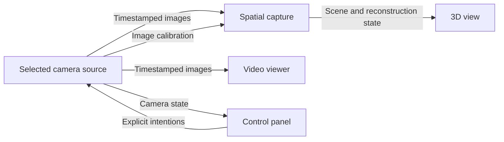

# Composable applications for OpenDeviceDB

Status: initial product specification, translated from the French discussion on
5 November 2026. The owner authorized implementation after this specification is
committed. Requirements describe the intended product, not a claim that every
feature is already implemented. Formats, names and paths below remain proposals
unless an implementation decision explicitly resolves them. The existing device
record schema is preserved.

## 1. Intent and decisions from the discussion

From a device page or the analysis of a USB-connected device, a person must be able
to identify their device, discover available functions and use them through free
software components. They must also be able to assemble those components in the
page, like Lego, and share their application. Documentation and links to original
projects remain accessible.

Processing and interface components also exist independently of devices. They can
be discovered in the catalogue and assembled into applications without an associated
device record or a connected device, for example to reconstruct a 3D scene from
recorded images. Device pages and USB analysis are additional entry points to
compatible components and applications.

The project owner's decisions are:

- Initially keep WASM modules, web components, contracts, compositions and tests in
  the OpenDeviceDB repository, organized independently of device records.
- Accept processing and interface contributions independently of work on a device's
  low-level protocol.
- Open WASM porting of business logic to any contributor, independently of the
  original project's authors and the people who documented the device.
- Reuse processing across devices: spatial capture is the reference use case,
  with different drones or cameras providing images.
- Present a ready-to-use application by default; visual block composition is a
  customization mode within the page.
- Allow people to export that application for their desktop, including its
  components and configuration.
- Allow AI agents to discover and integrate components into the applications they
  create, through OpenDeviceDB's MCP server.
- Provide components inspectable by people and agents: contracts, documented
  behavior, matching sources and accessible tests.
- Accept direct WASM/WAT instruction authoring alongside ports from existing
  languages, under the same validation requirements.
- Make community contributions central to hardware testing and validation,
  including contributions from people who do not program.

The following sections propose the mechanisms supporting these decisions. Tooling,
binary interoperability and artifact hosting choices remain open. Implementation
authorization does not turn proposals into claims of delivered functionality.

## 2. User journeys

### Use an application

1. From the catalogue, a device page or USB-connected device analysis, choose a
   compatible application.
2. Review its functions, target requirements and, when hardware is needed, the
   tested models and firmware versions.
3. Select the required sources, authorize the necessary access and start the
   session. Device access is requested only when the application needs it.
4. Use the offered controls and visualizations.
5. Stop the session, save a result or choose to share a report.

USB analysis results provide direct access to the compatible functions, applications
and components available for the selected device, including **Customize**. Visiting
a device page is optional. The selected device context is preserved when opening
an application or its customization; necessary permissions remain explicit.

The initial screen is the ready-to-use application: controls, data and
visualizations. Normal use does not require opening a graph or an empty assembly
page. A **Customize** button opens the Lego workshop from that application's
composition.

The first hardware access requires explicit authorization. A previously authorized
device may be recognized without replaying previous actions. Hardware API
restrictions must be displayed before promising that an application works in the
current environment.

### Customize an application

The workshop opens a working copy of the chosen composition, including its blocks,
connections, parameters and layout. A palette offers blocks available for the
existing inputs. People can add or remove functions, configure blocks and rearrange
the interface. Two views represent the same customization:

- **Layout**: place and resize visible components in the page.
- **Connections**: place blocks, connect their ports and configure their parameters.

The complete graph is available for advanced customization. Processing blocks with
no interface remain visible there. Errors identify the block, port and missing
condition. An incomplete assembly can be saved as a draft but cannot be started
as if valid. Both views must be usable with a keyboard.

Changes do not alter the original published composition or the commands of a
running session. The person explicitly chooses to apply/start a valid revision and
can return to the application. They can save their customized composition or offer
it for sharing through the contribution workflow. Starting from an empty page
remains a separate entry point for composition authors.

### Export for the desktop

From the application or customization, **Export an application** proposes an
available target suited to the user's machine and allows another target to be
chosen. The profile states the operating system, architecture and package format.
The site presents compatible functions, hardware/software prerequisites and any
network dependencies, then prepares a downloadable application. The person can
install or launch it, depending on the format, without compiling the project
themselves. Their composition, settings and interface are preserved.

Downloading a composition and downloading a desktop application are distinct
deliverables. The application must include the host engine, WASM modules,
interfaces, version lock and required redistributable resources. Any system
prerequisites that are not bundled are stated. Hardware permissions are obtained
on the destination machine; they are not transferred from the browser.

An application whose functions and resources are entirely local must work without
OpenDeviceDB access after installation. Functions requiring a remote service keep
that dependency visible. The package provides access to its composition, licenses
and corresponding sources so that it can be rebuilt and modified.

### Reuse components with an AI agent

A person can ask their agent, for example: “Create a desktop application that reads
my camera and uses OpenDeviceDB's spatial capture component.” The agent consults
the catalogue through MCP, selects versions compatible with the target, retrieves
contracts and examples, then integrates components into the user's project. This
journey also supports business applications created outside the visual editor.

The agent can assemble an existing composition or use component APIs directly
through a documented integration library. Creating the application does not
require rewriting a protocol already supplied by a module. The resulting
application executes components with its host and can subsequently work without
an AI agent or a connection to the MCP server.

### Contribute

A person can publish an adapter, processing component, WASM port, interface,
composition, test fixture or hardware report. Contributions to a low-level protocol
or the original source repository are not prerequisites for other contributions.
Authors can work with recorded data or simulators; device owners can subsequently
contribute hardware trials.

## 3. System objects

| Object | Contents and role |
| --- | --- |
| Device record | Identity, sources, variants and links to compatible uses/compositions. |
| Component | Versioned unit with source, license, ports, parameters, environment and tests. |
| Connection contract | Versioned definition of a port's data, commands and constraints. |
| Composition | Component instances, versions, connections, parameters, sources to select and interface layout. |
| Test report | Results tied to exact versions and an environment, identifying the kind of evidence. |

A component has an identity independent of device records; publishing and using it
does not require attaching it to a device. Compatibility depends on its contracts,
resources and execution environment. It may have several roles or consist of a
group of blocks:

- **Adapter**: communicates with a device and exposes common functions.
- **Processing**: transforms data, for example images into 3D geometry.
- **Interface**: visualizes a result or emits control intentions.
- **Subcomposition**: encapsulates an assembly and exposes its ports and parameters.

Several models may share a protocol adapter, with profiles describing their
differences. A subcomposition is a shareable component; its dependencies are
explicit and recursive references are rejected.

### Community porting of business components

A component can start from an existing free software project in Python, C/C++,
Rust or another environment with native dependencies. A device record may reference
that work before a browser module exists. Progressive community porting is part
of the registry's intended operation.

Any contributor may propose a port of useful business logic, its adaptation to
shared contracts and its packaging as WASM. They need not be the original
repository's author, have documented the protocol or own the device. Another
contributor can provide the web interface and a hardware owner can run trials.
Attribution and source licenses are preserved. A port can be maintained in
OpenDeviceDB without waiting for an upstream merge.

A contribution may cover a library or an extracted function; the registry does
not require porting the entire original application. Reused parts, adaptations,
dependencies and limitations are documented explicitly.

Porting progress distinguishes **source referenced**, **port in progress** and
**WASM artifact available for a declared target**. This is independent of evidence:
fixture tests, reported hardware results and documented reproductions. An available
artifact may still lack hardware tests.

A port proposal states the source project/version, intended functions, proposed
contract, published work and outstanding needs. Device pages and the catalogue
make proposals discoverable and open to contributions. A module appears as
executable in the palette only after a manifest and artifact compatible with the
engine are published; proposals remain browsable. Porting progress does not
prevent the use of other ready components.

### Reference use case: spatial capture



The source may be a drone adapter, a browser-accessible camera or a recording.
Replacing the source must not require changing processing or the 3D view when
their input contracts remain satisfied.

Compatibility remains conditional on available data. Missing calibration, an
incorrect image format or incompatible clocks must produce an explanation rather
than a silently accepted connection.

The existing [Spatial Capture 3D package](https://github.com/smichea/spatial-capture-3d)
is a functional reference, not an available WASM module. Its
[Python manifest](https://github.com/smichea/spatial-capture-3d/blob/e14ec1702e934d473c3327bcaaeeafba061bc127/pyproject.toml)
includes pycolmap; its README also describes external native tools and experimental
continuous acquisition. Its WASM port illustrates the community business-logic
contribution described above. Port authors, interface authors and hardware testers
may be different people. Port performance and browser access to the Neo 2 stream
will be established by that work and its trials. The contract must support this
family of uses without claiming that every camera is already compatible.

## 4. Contracts: the Lego connectors

Each port declares its direction, kind, contract and version, and constraints.
Three kinds are proposed:

| Kind | Examples | Behavior |
| --- | --- | --- |
| Value/state | Calibration, parameters, connection state | Latest known value and change notification. |
| Stream/event | Image, measurement, new scene revision | Ordered, timestamped items with a flow-control policy. |
| Action | Read information, change a setting | Request/response, identifier and explicit result. |

The first contracts to define cover images, calibration, measurements with units,
3D scenes and actions. Illustrative names are `odb.video.frame/1`,
`odb.camera.calibration/1` or `odb.scene.revision/1`.

As applicable, a contract states format and dimensions, units, spatial frame,
clock origin and domain, source and session identifiers, calibration validity,
unknown values, errors and version. An image transformation must update affected
geometric information. Changing the camera creates a new context; data from
different sessions is not mixed.

The editor checks directions, contracts, versions and constraints before startup.
An explicit converter may make two ports compatible. A matching port name or a
numeric conversion is not sufficient proof of compatibility. Data-dependent
constraints are also checked at runtime.

An output can feed several inputs. Each consumer states its policy: keep the
latest item, retain all items within a limit, or slow down the producer if
supported. Loss and delay are observable. Queues are bounded and original
timestamps are preserved. Large data travels in engine-managed buffers or
resources, with ownership, copying and release rules defined by the API. It is
not serialized frame by frame into the composition file.

In the first version, the data graph is acyclic. Actions use separate connections;
they are neither repeated nor automatically replayed on reconnection. A continuous
control loop would need a later contract defining its timing and stop behavior.

## 5. Manifests and saved compositions

### Component manifest

| Group | Proposed required information |
| --- | --- |
| Identity | Stable identifier, version, description, authors and maintainers. |
| Freedom and sources | SPDX license, repository/commit of the port and each reused upstream source, attribution, build recipe and licenses of distributed dependencies. |
| Execution | WASM, web interface or subcomposition; engine API version; entry points; required features and host services; declared and tested targets. |
| Artifacts | Controlled publication path or URL, digest, build provenance and corresponding source. |
| Inspection | Contracts and behavior documentation, readable sources tied to the exact binary, examples/tests and symbol/debug references when available. |
| Connections | Ports, contracts, versions, constraints and validatable parameters. |
| Access | Required devices/interfaces and operations; any network or file access. |
| Resources | Memory, queue sizes and other engine-supported limits. |
| Tests | Scenarios, fixtures, expected results and human observation instructions. |

Persistable parameters are distinguished from secrets and session context. A
component configuration is validated before execution. These requirements apply
to an executable component; a port proposal may be published with the tracking
information above, without a fabricated artifact or a contract falsely presented
as finalized.

### Agent-inspectable components

Publication must provide the information needed to use a component, and its
sources for studying or changing the implementation. The normal journey does not
require reconstructing a high-level program from its binary. An inspection package
may be delivered alongside the module; its references and digests belong to the
same versioned release.

It contains typed interfaces, inputs/outputs, units, effects, preconditions, errors,
states and documented limits, plus required host services. Automatically checkable
conditions are represented structurally; assumptions and human observations remain
identified. Business names for functions and parameters are preserved in interfaces
and sources.

Sources correspond to the published artifact: commit, build recipe, tool versions
and digests are pinned. For directly authored WASM, readable WAT serves as source,
with the necessary build information. Available names and debugging information
are retained or supplied separately with an explicit mapping. Converting a binary
to WAT does not by itself recover the intentions and abstractions of optimized
source code.

WIT is a candidate for typed interfaces; it describes exchange contracts, not the
implementation's entire behavior. Functional descriptions and tests remain
necessary. Publication checks compare declared signatures and services with real
imports/exports, verify artifact correspondence and run available executable
scenarios. They distinguish declared behavior, a test result and an actually
verified property.

Inspecting metadata and binary structure does not require running the module.
An agent can retrieve only the interfaces, source functions or fixtures it needs.
A shareable composition already gives a readable graph representation; block
sources allow inspection of internal logic.

### Direct WASM/WAT authoring

Two authoring paths are accepted: compile/port existing free code or directly
produce WASM instructions. WAT is their standard textual representation. An agent
can generate it and use an assembler and validator to obtain a binary. A typed
instruction-building API with binary encoding is another path to investigate.

The proposed workflow is: requirements and contracts, WAT sources or structured
construction, assembly/encoding, WASM validation, contract/behavior tests, then
versioned publication. Readable WAT sources are retained even if a tool produces
the binary directly. Binary conversion remains a build step; the host may then
compile or interpret the module at runtime.

This path does not impose a high-level language on the author. Its value compared
with a conventional port must be assessed on concrete tasks: protocol decoding,
stream transformation and business computation. Evaluation covers correctness,
resources, performance and ease of modification, without assuming that direct
generation is superior for complex algorithms. Ports of existing libraries remain
first-class contributions.

Both paths follow the same contract, license, traceability and testing rules.
WASM validation establishes module well-formedness and type constraints; business
results are assessed by corresponding tests and review. No module is presented as
hardware-validated solely because an AI generated it or a validator accepted it.

### Composition description

The format must be readable, versioned, importable and exportable. It preserves
instances, exact versions and digests, connections, parameters, public ports,
hardware source slots and the layout of both views. It stores no browser
permission, key or personal device identity.

Conceptual example, not a final schema:

```yaml
format: odb-composition/1
id: examples/camera-preview
nodes:
  - id: camera
    component: examples/camera-adapter
    version: 0.0.0
    source_slot: selected-camera
  - id: viewer
    component: examples/video-viewer
    version: 0.0.0
connections:
  - from: camera.frames
    to: viewer.frames
layout:
  application:
    viewer: { x: 0, y: 0, width: 12, height: 8 }
```

These identifiers are fictitious. An executable export includes artifact and
dependency locks. Importing starts nothing and downloads no arbitrary executable
code before validation and user choice. Changing a version creates a new revision
with a new validation scope.

### Application package and target profile

An export pins the composition, host engine version, artifacts and their digests,
required hardware services, resources and license/source information. Its profile
identifies the target and variants, such as operating system, architecture and
required WASM features. Resolution checks the entire dependency chain; a component
available for the web is not assumed compatible with a desktop or mobile host.

Export reports an incompatible target or a non-redistributable resource before
offering an application as ready to download. It preserves the engine's isolation
and permission properties. Private settings, secrets and session identifiers are
not incorporated into a shared package.

Producing packages requires a build pipeline per target and, depending on
distribution, signing/notarization. The existing static site does not supply that
pipeline: a generation service, dedicated CI or prebuilt-host assembly strategy
must be chosen. The decision must cover costs, signing-tool access, composition
privacy and target availability. A source project the user must compile does not
satisfy desktop export for non-developers. Tauri is a candidate to evaluate for
the application shell and packaging, not an established choice; see its
[distribution documentation](https://v2.tauri.app/distribute/).

Tracking distinguishes an export request, preparation/build, an available package
and failure. Building a package does not validate its functions on hardware. An
export preserves selected versions; updates follow a new explicit resolution.

## 6. Execution engine and hosts

### Common contract and environments

The engine exposes the same business contract to components, with services
implemented for each environment. The first proposed host is the web page; the
design must also support a desktop host and integration into mobile or server
applications. Community ports may target a subset of these environments.
Available targets and tested targets are declared separately.

| Host | Intended access and presentation |
| --- | --- |
| Browser | Available and authorized web APIs; web components in the page. |
| Desktop | Bundled WASM engine, native hardware services and embedded web or native interface. |
| Mobile | Embedded engine or WebView, with Android/iOS-specific services and permissions. |
| Server | Headless execution, explicit inputs/outputs and declared local or remote hardware access. |

Reusable business logic uses declared host services without requiring browser
objects. Reusing the same artifact requires compatible interfaces and features.
Web interfaces can be reused in a WebView; a native interface uses the same
contracts with its own visual elements. A server profile defines useful inputs
and outputs without a display component. It does not implicitly gain access to
devices attached to a user's computer.

### Session lifecycle

The engine resolves components, validates the graph, supplies authorized access
and connects blocks. Its lifecycle is prepare, bind, start, stop, release.
Dependencies are prepared before producers. A preparation failure releases
resources already acquired.

A session owns its instances and hardware context. An adapter opens one session
per controlled device/interface, then distributes data to authorized consumers.
The engine reports access conflicts. On stop or disconnection it cancels pending
actions, closes resources and marks outputs complete or stale. It does not
present an old frame as a current measurement or view.

Expensive processing runs off the interface thread where one exists. Browser
Web Workers provide this mechanism; they do not by themselves establish plugin
authorization. See [Using Web Workers](https://developer.mozilla.org/en-US/docs/Web/API/Web_Workers_API/Using_web_workers).

### Hardware access and contributor code

The engine supplies WASM with functions required and declared by its manifest.
A module does not implicitly gain network, file or all-device access. Compiling
to WASM does not replace browser restrictions or system prerequisites. See
[WebAssembly security](https://webassembly.org/docs/security/) and
[WebUSB](https://developer.mozilla.org/en-US/docs/Web/API/WebUSB_API).

Interface intentions pass through the engine before reaching an adapter.
Browser permissions and the operations authorized for a block are distinct
levels. Commands are bound to the authorized device, session and function;
access to one measurement does not grant every action. Reading a result may
require a protocol request: authorized effects are defined by the function,
not solely by USB transfer direction.

For contributed interfaces, the proposal is to execute Web Components in isolated
frames connected by validated messages. The engine provides the envelope;
contributor code is not imported into the host page with its privileges. Shadow
DOM encapsulates the interface but does not isolate execution permissions. Origins,
sandboxing, CSP and message channels must be specified and checked before any
third-party plugin execution. See
[Web Components](https://developer.mozilla.org/en-US/docs/Web/API/Web_components)
and [iframe sandbox](https://developer.mozilla.org/en-US/docs/Web/HTML/Reference/Elements/iframe#sandbox).

The proposed initial scope is local browser execution, complemented by desktop
export and MCP integration goals. Exchanges remain limited to declared access.
Downloading a module is distinct from uploading measurements; data collection or
report publication is never implicit. Desktop native services can extend available
transports through a separately declared environment and permissions.

## 7. Registry, free sources and device integration

Initially, the OpenDeviceDB repository hosts sources, manifests, contracts,
interface components, compositions and tests. No separate repository is planned
at this stage. Components are organized independently of device records: a device
page or application references their identifiers and versions without copying code.

Reused upstream libraries remain attributed and linked; a port preserves its
origin and sources required to rebuild it. Distributed code and artifacts must
respect their licenses and the [project policy](../../POLICY.md).

Compiled artifacts are tied to a release and their exact sources. The initial
proposal is CI/repository releases plus a static index pinning digests. Whether
binaries are stored in git history or releases remains to be decided. A digest
identifies an artifact; it does not prove correct operation.

Two catalogues complement each other: devices and components/compositions. The
component/application catalogue is directly browsable without first selecting a
device. A device page references known adapters and possible applications.
Resolution distinguishes identifier matching, contract satisfaction, environment
availability and operational evidence. A VID:PID shared by a serial adapter or
bootloader does not identify the physical model; appropriate selection/probing
is still necessary. Every probe and its effects must be declared.

Existing device statuses are preserved. A free firmware or documented protocol
does not imply a function works on a given target. Execution results are shown
by application, function, variant and environment. Existing device records
without modules remain valid.

Component publication follows repository contributions. A version can be
deprecated or removed from default discovery, with a reason and a notice to
users of affected compositions. Updates never silently replace locked versions.

### MCP discovery and integration

The existing MCP server primarily exposes device records and research tracking;
see its [current interface](../../packages/mcp/README.md). This evolution adds
component discovery and integration. The operations below are proposed names,
not claims that the tools are already available.

| Proposed operation | Expected result |
| --- | --- |
| `search_components` | Search by function, contract, device or target, with availability and testing level. |
| `get_component` | Exact version, manifest, ports, dependencies, licenses, evidence and artifact/source references. |
| `inspect_component` | Inspection package, binary structure/imports/exports, contracts, sources and tests tied to the same version, without running the module. |
| `resolve_composition` | Compatible versions and lock, missing components, required host services and diagnostics for a target. |
| `validate_composition` | Structure, connection and parameter checks; unknown hardware conditions distinguished from errors. |
| `get_integration_guide` | Integration API, examples, project resources and contract tests suited to the supported target/language. |
| `prepare_app_export` | Export plan, prerequisites and build-workflow reference; no implicit build or publication. |

Contracts, guides and examples may be MCP resources; queries and validations may
be tools. The protocol provides those mechanisms, while registry operations are
OpenDeviceDB-specific. References:
[MCP tools](https://modelcontextprotocol.io/specification/2026-07-28/server/tools)
and [MCP resources](https://modelcontextprotocol.io/specification/2026-07-28/server/resources).

Agent-consumable results include a response format version, exact identifiers and
versions, resolved target, contracts, host requirements and known evidence.
Examples and bindings correspond to the same versions. Large artifacts are
referenced by URI and digest; access and license controls also apply to retrieval.
Partial results explain missing pieces without inventing an API, an available
port or a hardware test.

Guides must allow a component or assembly to be integrated into an external
project using the corresponding host/SDK library. The common contract and
conformance tests are shared with the web editor and desktop exporter. An agent
can produce its own screen or reuse registry interfaces. Its project retains
locks and attribution for reused components.

Discovery and preparation have no hardware effects. Writing into a project,
running a build or testing a device subsequently uses the tools and permissions
of the agent's environment. Publishing an application or commanding a device is
not an implicit consequence of an MCP search or of writing this specification.

## 8. Community validation

Each component supplies contract tests and reproducible scenarios. Processing
and interface components can be tested on fixtures without a device. Adapters
add guided hardware scenarios; human observations are separate from automatic
assertions. A decoded response and a measurement compared with a reference are
different kinds of evidence.

**Test and contribute** allows the person to choose functions to try, inspect
planned operations, run the scenario and review a report before sharing it.
Operations changing settings are explicit. The proposed initial scope excludes
firmware flashing from pages.

A report retains component, composition and test-suite versions/digests, device
variant, firmware if known, engine environment, date, per-function results
(`passed`, `failed`, `partial`, `skipped`, `unknown`), automatic assertions, human
observations and selected reproduction material. Serial numbers, personal
identifiers, secrets and private captures are excluded from public reports by
default. The user reviews every attachment.

Display distinguishes declared compatibility, a fixture test, a reported hardware
result and a documented hardware reproduction. It shows comparable successes and
failures, dates and conditions without extending a result to other versions or
variants. Independent confirmation is identified with provenance; duplicate
submissions do not become independent confirmations.

The community can correct and contest reports. Maintainers handle duplicates and
review necessary evidence before promoting it to “verified.” Existing
[SPEC.md rules](../../SPEC.md) remain the basis of device verification. Reports
do not automatically change a device's overall status.

Proposed storage follows the git/static model: tests alongside components,
structured public reports contributed to the repository and build-time
aggregation. Submission should minimize friction; no central application account
is required to use a composition. Whether reports use GitHub forms or file
contributions remains open.

## 9. Proposed acceptance criteria

These criteria concern the intended implementation; listing them is not evidence
that they have been executed.

| ID | Expected demonstration |
| --- | --- |
| AC-01 | Check both entry points, a device page and USB-connected device analysis: access compatible functions, applications and components, use a documented function and open Customize. The USB journey preserves selected device context without requiring a device page visit. |
| AC-02 | Publish and use a processing component and an interface without contributing low-level code. |
| AC-03 | Replace a source with another satisfying the same contracts without changing processing or visualization. |
| AC-04 | Build, save, export and reopen an assembly with its versions, connections, parameters and layout. |
| AC-05 | Encapsulate an assembly as a reusable block and reopen it without losing dependencies. |
| AC-06 | Reject an incompatible connection, explain missing calibration and report lost context/session. |
| AC-07 | Stop a session, handle disconnection and release access without replaying commands on reconnection. |
| AC-08 | Keep the interface responsive and queues bounded with a slow consumer; expose losses. |
| AC-09 | Verify that a block cannot access an unauthorized device, function, host resource or network. |
| AC-10 | Produce and review a community report, aggregate successes and failures by configuration, excluding private data by default. |
| AC-11 | Keep locked artifacts and report a withdrawn version or unavailable dependency. |
| AC-12 | Distinguish a proposed application, fixture-validated execution and hardware reproduction; preserve existing records. |
| AC-13 | Reference a source project before porting, accept WASM from a different contributor and trials by other people, retaining attribution and separate tracking of port progress and evidence. |
| AC-14 | Use an application without opening a graph, retrieve its composition through Customize, modify it and return to a usable application without altering the published original. |
| AC-15 | Export a compatible composition to an announced desktop target, download and launch its package without manual compilation; verify local operation without OpenDeviceDB when its functions are local. |
| AC-16 | Through MCP, find a component, resolve versions and obtain a guide enabling an agent to integrate it into an external project; run contract tests and retain the same artifacts and real hardware evidence state. |
| AC-17 | Explain a missing target/dependency before export or integration, distinguishing preparation, a built package and on-device validation. |
| AC-18 | Inspect a module through MCP without executing it, retrieve contracts, documented behavior, corresponding sources and tests; detect inconsistent signatures or digests. |
| AC-19 | Accept a WAT-authored module and a module compiled from another language under the same publication requirements, distinguishing WASM validation, business tests and hardware validation. |
| AC-20 | From the catalogue, discover and use processing and interface components without an associated device record or connected device, with a recorded/simulated source satisfying their contracts. Retain the same identifiers and versions in an application using a compatible device. |

Reuse demonstrations start with a simulated/recorded source and a real source.
Claims covering multiple devices then require trials on those devices. 3D capture
remains a contract/porting goal to investigate; an image-filter demonstration does
not qualify it.

## 10. Decisions to resolve and specification steps

| Question | Starting proposal | Still to establish |
| --- | --- | --- |
| Hosts and transports | Web first, desktop export and external MCP integration; architecture open to mobile/server. | Available pilot targets, native services and per-host compatibility matrix. |
| WASM/host connection | Shared port API; investigate Component Model/WIT for interfaces. | ABI, asynchrony, buffer management and supported toolchains for chosen targets. |
| Visual editor | Evaluate Rete.js and React Flow; keep composition format independent of the editor. | Accessibility, site integration, performance and maintenance. |
| Contributed interfaces | Web Components in an engine-managed isolated envelope. | Origin/CSP model, messages, layout and video/3D performance. |
| Artifacts and licenses | Free sources in the repository; artifacts tied to explicit builds and licenses. | Releases or git for binaries; dependency-compatible license policy. |
| Community reports | Generated, reviewed and voluntarily contributed reports; static aggregation. | Simple contribution journey and evidence review/promotion rules. |
| Community ports | Proposals visible before an artifact exists; contributions open for logic, interfaces and tests. | Minimal proposal format and tracking of shared work/dependencies. |
| Spatial capture | Interchangeable image/calibration/timestamp contract and processing; community business-logic port. | Native dependency port results, memory/throughput budgets and camera streams, established by contributions and trials. |
| Desktop export | Complete downloadable application, embedded composition and locked versions. | Application shell, targets/architectures, package generation, signing and hosting/build costs. |
| MCP and external integration | Catalogue, contracts, resolution and guides; components in agent-created projects. | Tool/resource schemas, per-target SDK/bindings and export preparation journey. |
| Inspection and direct authoring | Sources/contracts/tests accessible for every module; WASM/WAT alongside compilation. | Inspection package, source/binary correspondence, generation tooling and direct-authoring evaluation protocol. |

The implementation design must specify a complete manifest, contract and composition
example, a pilot environment compatibility matrix, isolation model, desktop export
deliverables, MCP/SDK contracts and test aggregation rules. It must also detail the
inspection package and direct WASM/WAT authoring journey. Choosing an editing tool
does not precede these contract decisions.

## 11. Technical references and relationship to existing work

Sources consulted on 5 November 2026 establish technical possibilities, not the
existence of integrations in OpenDeviceDB.

- [Current detection](../../site/src/scripts/detect.ts) and [USB matching](../../packages/core/src/detect.ts): starting point for device selection and identifiers.
- [Existing specification](../../SPEC.md) and [device schema](../../schema/device.schema.json): current catalogue and verification. This proposal extends v0/R1 without rewriting their delivered state.
- [WebUSB](https://developer.mozilla.org/en-US/docs/Web/API/WebUSB_API), [WebHID](https://developer.chrome.com/docs/capabilities/hid) and [Web Serial](https://developer.chrome.com/docs/capabilities/serial): transports dependent on browser, system and permissions.
- [WebAssembly Component Model](https://component-model.bytecodealliance.org/introduction.html): interfaces and composition to evaluate without assuming universal native browser support.
- [Streams API](https://developer.mozilla.org/en-US/docs/Web/API/Streams_API): stream and flow-control mechanisms to investigate.
- [Rete.js](https://retejs.org/) and [React Flow](https://reactflow.dev/learn): visual composition candidates, not established choices.
- [Node-RED](https://nodered.org/about/): composition experience reference; its Node.js engine is not implicitly selected for page execution.
- [WASM beyond browsers](https://webassembly.org/) and [Wasmtime](https://docs.wasmtime.dev/stability-platform-support.html): host execution and variable platform coverage.
- [Tauri](https://v2.tauri.app/start/) and [distribution](https://v2.tauri.app/distribute/): possible desktop/mobile shell and package-generation constraints.
- [MCP 2026-07-28](https://modelcontextprotocol.io/specification/2026-07-28): design reference for new operations; this specification does not itself migrate the existing server.
- [WASM text format](https://webassembly.github.io/spec/core/text/index.html) and [WABT](https://github.com/WebAssembly/wabt): WAT, assembly, inspection and validation.
- [WIT](https://component-model.bytecodealliance.org/design/wit.html), [debugging information](https://github.com/WebAssembly/tool-conventions/blob/main/Debugging.md) and [WASM validation](https://webassembly.github.io/spec/core/valid/conventions.html): interfaces and traceable sources, distinct from behavior evidence.
